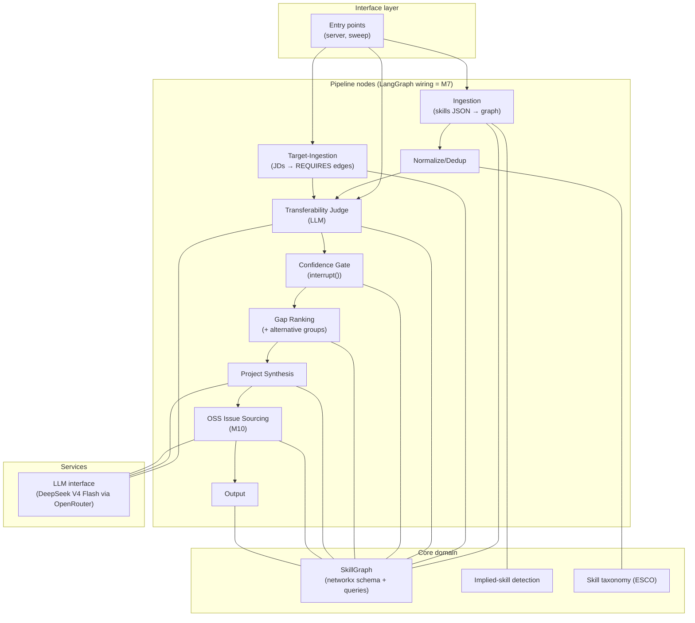

# System Overview

The top-down view of the Skill-Gap Agent: what the system is, its layers and
components, where each lives in code, and how data flows through. This page
is the **map and router** — high-level detail only. Per-stage mechanics live
in S1–S7 (`04-reader.md` through `10-flow-runner.md`); non-stage components
own their own files (`11-sweep.md`, `12-extension.md`, `13-intake.md`,
`14-observability.md`, `15-desktop-companion.md`); the Stage Table and the
component list below route to them. (Folded from
`2-architecture.md`, 2026-09-27 — that file's stage stubs duplicated the
S-files. The M9 design and graph schema that survived that merge have since
moved to `13-intake.md` and `06-skill-map.md`, their owning files.)

**Status: v1 built and validated** (M1–M6); **M7–M28 delivered except
M17 (designed; M27 folded into M28); M29 install path in progress** (29a
built; 29b/29c implemented, verification pending; 29d planned). The
extension is the only user surface since M28, with one central workspace;
all pipeline stages are built and validated against a sealed hand-performed
gap analysis of the same data (rubric in S5 `08-gap-measurer.md`
§Validation rubric). M17 tooling is the only designed component below.

This is a **living target-state document**: it describes the full system we
are building (current end goal = v2), with every component labeled Built
(exists in code) or Designed (specified for an upcoming milestone, no code
yet). See the spec-evolution rules in
[.github/copilot-instructions.md](../.github/copilot-instructions.md).

## What the system does (one paragraph)

Given a user's skills evidence and target job descriptions, the agent builds
a weighted skill graph (networkx), detects skills the CV *implies* but doesn't
state (user-approved), scores how much existing skills transfer to missing
ones (LLM judge), gates uncertain judgments through a human-in-the-loop
prompt, ranks gaps by JD frequency, and outputs a ranked plan of grounded
learning projects. Validated against a sealed hand-performed gap analysis of
the same data (rubric in S5 `08-gap-measurer.md` §Validation rubric).

**Target additions:** users converse with the agent instead of preparing
input files — they hand over a resume (PDF/DOCX) or skills JSON, the agent
extracts skills via one LLM call, validates the depth of ranking-relevant
skills through calibration questions (not a test), and the whole pipeline
runs as a true LangGraph graph with `interrupt()`-based human-in-the-loop
steps (design: [13-intake.md](13-intake.md)).

## Layered Component Map



## Stage Table (router — mechanics live in the S-files)

| Stage | Purpose | Code | Spec | Status |
|---|---|---|---|---|
| S1 reader | Raw text capture (resume + JDs), no AI | `resume.py`, `ingest.py` file loop | [04-reader.md](04-reader.md) | ✅ Built (M2 JSON/TXT; M8 PDF/DOCX) |
| S2 AI caller | Single LLM door (`judge`/`chat`), keyring secrets | `llm.py`, `secrets.py` | [05-ai-caller.md](05-ai-caller.md) | ✅ Built (M3); M15 presence policy ✅ Built; M16 free-tier + retries ✅ Built (M16) |
| S3 skill map | Graph store: schema + queries, JSON round-trip | `graph.py` | [06-skill-map.md](06-skill-map.md) | ✅ Built (M1) |
| S4 skill cleaner | Dictionary + both-side cleaning + implied + bridge | `normalize.py`, `taxonomy.py`, `implied.py`, `vocab_bridge.py` | [07-skill-cleaner.md](07-skill-cleaner.md) | ⚠️ Split (manual Built; bridge unwired) |
| S5 gap measurer | Judge + gate + ranking; validation rubric lives here | `judge.py`, `gate.py`, `ranking.py`, `requirements.py` | [08-gap-measurer.md](08-gap-measurer.md) | ✅ Built (M3–M6) |
| S6 practice planner | Standalone synthesis + OSS issues + rendering | `synthesis.py`, `oss.py` (M10), `output.py` | [09-practice-planner.md](09-practice-planner.md) | ✅ Built (M5 + M10 thin slice) |
| S7 flow runner + screen | LangGraph wiring + the local HTTP runner | `cli.py` (engine only), `server.py` | [10-flow-runner.md](10-flow-runner.md) | ✅ Built (M7–M8 + M11); CLI surface retired (M28) |

**Non-stage components** (own spec files — same rules as the S-files):

| Component | Purpose | Code | Spec | Status |
|---|---|---|---|---|
| C1 sweep harness | JD-subset evaluation over the built pipeline | `sweep.py`, `m12_check.py` | [11-sweep.md](11-sweep.md) | ✅ Built (M12) |
| C2 extension shell | Browser capture + side-panel gaps/plan | [../extension/](../extension/), `m13_check.py`, `m14_check.py` | [12-extension.md](12-extension.md) | ✅ Built (M13 + M14 self-serve setup); M15 toggle ✅ Built; M16 connect + free mode ✅ Built (M16); M29 companion onboarding 🎯 Designed (29c implemented; live pass pending) |
| C3 intake + validation | In-panel intake chat + evidence-backed skill depth (depth-aware judge); one central workspace store | `intake.py`, `validate.py`, `store.py` | [13-intake.md](13-intake.md) | ✅ Built (M9, 2026-10-12; store simplified M28, 2026-10-25) |
| C4 observability + judge evaluation | Debug logging + LangSmith tracing + judge golden-set eval | `debuglog.py` (M26), `tracing.py`, `judge_eval.py`, `evals/` (planned) | [14-observability.md](14-observability.md) | ✅ Built (M26 debug mode); 🎯 Designed (M17) |
| C5 desktop companion + distribution | Tray companion, bundled runtime, Windows installer, release pipeline, consumer onboarding | `desktop.py`, `packaging/`, `.github/workflows/windows-release.yml` | [15-desktop-companion.md](15-desktop-companion.md) | 🎯 Designed (M29); 29a built; 29b/29c in review |

## Pipeline (stage order = data flow)

```
resume / skills JSON ──▶ S1 reader ──┐
                                     ├──▶ S4 cleaner ──▶ S5 measurer ──▶ S6 planner ──▶ S7 screen
JD texts ────────────▶ S1 reader ────┘         (S2 AI caller + S3 map serve all)
```

## Data Flow at a Glance

```
IN:  data/skillsdataset.json (146 phrases)   data/jds/*.txt (16 JDs)
      │                                        │
      ▼                                        ▼
   canonical skills (118)                target skills (19)
   + implied skills (41)                 + REQUIRES weights
      │                                        │
      └──────────────┬─────────────────────────┘
                     ▼
            SkillGraph (networkx)
                     │
        unmatched targets (17) → LLM judge → TRANSFERS_TO edges
                     │
                     ▼
        confidence gate (M4) → gap ranking (M5) → plan.md (M5)

PERSISTED: output/graph.json (whole graph),
           output/judge_report.json,
           output/profile.json (intake + approval record, M9/M28)
```

_Counts are a fresh ingestion snapshot on 2026-10-03: 118 canonical + 41
implied vs. 16 JDs → 19 target skills → 17 unmatched. The judge-edge count
is LLM output and varies per run — the M12 sweep
([11-sweep.md](11-sweep.md)) refreshes numbers like these._

**Target flow (C3, restored 2026-10-12):** resume upload (rule-only) → JD
capture → Analyze gaps: LLM extraction → in-panel intake chat (phrase +
implied-skill review, skill validation, depth — JD-aware triage) → profile
saved in the central workspace (resume-identity guarded) → the depth-aware
judge consumes it (the gate shrinks to unvalidated skills).
Design home: [13-intake.md](13-intake.md).

## Component designs (high level here — details live in the owning file)

This page routes; it does not host design. Each entry is a summary plus a
link. If you need the mechanics, open the linked file.

- **C1 sweep harness (M12, Built)** — [11-sweep.md](11-sweep.md). Runs the
  pipeline over seeded JD subsets with shared judge/gate/OSS caches, and
  records which subset produced which plan.
- **C2 extension shell (M13 + M14, Built)** —
  [12-extension.md](12-extension.md). Chrome side panel: capture JDs on
  LinkedIn, analyze gaps, generate the plan against the local server. M14
  made setup self-serve, M15 added LLM modes, M16 free-tier OAuth, and M29
  companion-aware onboarding (29c implemented; live pass pending).
  Mechanics and policy live in the linked files.
- **C3 intake + skill validation (M9, ✅ Built 2026-10-12)** —
  [13-intake.md](13-intake.md). In-panel chat at Analyze gaps (upload stays
  rule-only); calibration questions make depth evidence-backed and the
  judge depth-aware (profile-stamped caches, no gate double-count).
  Supersedes the 2026-10-04 deferral ([02-decisions.md](02-decisions.md)).
- **C4 observability + judge evaluation (M17, 🎯 Designed)** —
  [14-observability.md](14-observability.md). Opt-in LangSmith tracing of
  every run (what happened inside it) plus a golden-set evaluation of the
  judge (is it right) — tooling around the pipeline, not a stage.
- **C5 desktop companion + distribution (M29, 🎯 Designed; 29a built,
  29b/29c in review)** — [15-desktop-companion.md](15-desktop-companion.md).
  Bundled tray companion (no system Python), per-user Windows installer,
  signed CI release, and the two-install consumer journey. Panel
  onboarding: [12-extension.md](12-extension.md) §M29.

## Skill graph schema (summary — canonical reference in S3)

Nodes `Skill` / `JD` / `Project`; edges `HAS_SKILL`, `REQUIRES{weight}`,
`TRANSFERS_TO{confidence, rationale, gate_*}`, `CLOSES_GAP`. Store-agnostic
and deliberately Neo4j-shaped so the store can migrate without redesign.
Full tables, properties and per-edge writers: S3
[06-skill-map.md](06-skill-map.md) §Schema (that file owns `graph.py`).

## Repo Map

```
skill-gap-agent/
├── README.md                  ← project entry point (user quickstart)
├── .github/                   ← agent-gates + Windows release workflows
├── board/                     ← locks/, issues/, verify + maintenance reports
├── docs/                      ← derived human docs (overview, changelog, privacy policy)
├── maintenance/               ← maintenance charter (human-owned)
├── scripts/                   ← devkit task scripts (claim/release/verify/path_guard)
├── specs/                     ← you are here (numbered by reading order)
├── data/                      ← seed data (gitignored)
│   ├── skillsdataset.json
│   └── jds/                   ← 16 JD texts
├── extension/                 ← M13: Chrome extension shell (MV3, side panel)
│   ├── manifest.json          ← MV3 manifest (sidePanel + storage; host_permissions = localhost)
│   ├── background.js          ← service worker: opens the side panel on action click
│   ├── content.js             ← LinkedIn JD extraction (port of the bookmarklet logic)
│   ├── sidepanel.html/.js/.css← capture list + Analyze gaps / Generate plan + gap table + plan iframe
│   └── README.md              ← load-unpacked instructions
├── packaging/                 ← M29: PyInstaller frozen build + Inno Setup installer + release workflow
├── tools/
│   ├── linkedin_jd_bookmarklet.js ← S1 helper (pre-extension JD saver)
│   ├── start-server.bat       ← developer launcher (M14; M29 ships the companion)
│   └── generate_icons.py      ← M22: regenerate extension icons
├── src/skill_gap_agent/
│   ├── graph.py               ← CORE: schema + queries (the system's backbone)
│   ├── normalize.py           ← CORE: canonical terms + aliases
│   ├── ingest.py              ← CORE: ingestion + target-ingestion nodes
│   ├── implied.py             ← CORE: implied-skill detection + proposal flow
│   ├── resume.py              ← M8: resume (PDF/DOCX/TXT) → skills JSON
│   ├── vocab_bridge.py        ← M8: LLM-assisted vocabulary bridge (merge-or-new)
│   ├── taxonomy.py            ← CORE: ESCO loader with fallback
│   ├── llm.py                 ← CORE: provider-agnostic LLM interface (DeepSeek via OpenRouter)
│   ├── judge.py               ← CORE: transferability judge node
│   ├── gate.py                ← CORE: confidence gate (self-assessment: depth + intent)
│   ├── ranking.py             ← CORE: transferability-aware gap ranking
│   ├── requirements.py        ← CORE: alternative-skill groups (any-of semantics)
│   ├── synthesis.py           ← CORE: grounded project synthesis
│   ├── oss.py                 ← M10: GFI sourcing (Search Issues + S2 filter + cache)
│   ├── output.py              ← CORE: plan.md renderer (with JD traceability) + plan.html (M10)
│   ├── cli.py                 ← pipeline engine (M7): graph wiring + interrupt/resume,
│   │                            two-phase pause (M13), oss node + stage listener (M13 completion)
│   ├── server.py              ← M11 local UI + M13 run contract (captured JDs, phase gaps|plan,
│   │                            GET /api/gaps)
│   ├── sweep.py               ← M12: JD-subset sweep harness (seeded sampling + shared caches)
│   ├── store.py               ← M28: one central workspace (output/) + saved-session snapshots
│   ├── desktop.py             ← M29: tray companion entry point + data/log paths (built 2026-10-26)
│   ├── intake.py              ← M9: intake conversation state machine (phrases→implied→depth→checklist)
│   ├── validate.py            ← M9: skill validation protocol (author/grade, leakage, JD triage)
│   ├── debuglog.py            ← M26: local-only debug logging (off by default)
│   ├── checksupport.py        ← shared isolated-store helper for offline checks
│   ├── m3_judge.py, mN_check.py ← offline milestone checks
│   ├── test_m*.py             ← pytest wrappers for the light checks
│   └── (tracing.py, judge_eval.py planned for M17)
├── output/                    ← pipeline artifacts (gitignored):
│                                 the CURRENT session, one central location
│                                 (M28): profile.json, extracted_skills.json,
│                                 captured_jds/, uploads/, graph.json,
│                                 judge_report.json, gaps.json, plan.md,
│                                 plan.html, synthesis_report.json,
│                                 oss_issues.json, current.json;
│                                 saved_sessions/<name>/ — user snapshots;
│                                 root-owned: logs/, sweeps/.
│                                 Legacy global decision files retired at M9
│                                 (see 13-intake.md).
└── (no .env file)             ← API keys live in the OS keyring only (secrets.py;
                                  env-var override supported). No .env / .env.example.
```

**Scaffolding note:** the extension is the only user surface (M28 retired
the CLI). `server.py` is the entry point; `cli.py` is the LangGraph engine it
imports (`AgentState`, `build_app`, the nodes) and no longer has a `main()`.
The M9 modules (`intake.py`, `validate.py`, `store.py`) are library modules
consumed by the engine, not runners themselves. `sweep.py`
(M12) is an evaluation harness, not a runner — it calls the pipeline's stage
functions once per JD subset (see [11-sweep.md](11-sweep.md)).

## Conventions & Guardrails

Code-level conventions every change must follow. This section is **spec
content**: it evolves with the code, and behavior-changing PRs must keep it
accurate (workflow rules live in
[.github/copilot-instructions.md](../.github/copilot-instructions.md)).

- Python 3.11+, pydantic models for structured data, type hints throughout.
- LLM access is centralized in a single module (`llm.py`); parse via its
  JSON-extraction helpers and never call provider SDKs from node modules.
- No silent non-LLM output (M15 policy in
  [05-ai-caller.md](05-ai-caller.md) §LLM presence policy): every
  rule-based fallback is labeled with the provenance vocabulary defined
  in `llm.py`; never present rule-based results as LLM results.
- Human decisions persist in the session profile
  (`output/profile.json` — the workspace store, see
  [13-intake.md](13-intake.md)) and are re-applied silently on re-runs —
  follow this pattern for any new interactive flow. The legacy global
  decision files (`extracted_approvals.json`, `implied_skills.json`,
  `gate_overrides.json`, `extracted_skills.json`) are retired: never
  create or read them.
- Console output must be ASCII-safe (dev machines may run cp1252; use
  `.encode("ascii", "replace")`-style guards for LLM-generated text).
- Data files under `data/` and `output/` are gitignored; never hardcode
  absolute paths — resolve from the package or repo root.
- Canonical skill vocabulary flows through a single normalization module
  (`normalize.py`); never compare raw surface forms.

## Where to Go Next

- **Why these choices:** [02-decisions.md](02-decisions.md)
- **Build order + progress + trade-offs + open questions:** [03-milestones.md](03-milestones.md) (roadmap — §§Deferred/Open hold the rest)
- **Stage mechanics:** S1–S7 files (`04-reader.md` … `10-flow-runner.md`), routed via the Stage Table above
- **Component designs:** [11-sweep.md](11-sweep.md) (C1 sweep harness), [12-extension.md](12-extension.md) (C2 extension shell + M14 self-serve setup + M15 LLM mode + M29 onboarding), [13-intake.md](13-intake.md) (C3 intake + validation, Built M9), [14-observability.md](14-observability.md) (C4 observability + judge evaluation, Designed M17), [15-desktop-companion.md](15-desktop-companion.md) (C5 companion + distribution, Designed M29)
- **Skill graph schema:** S3 [06-skill-map.md](06-skill-map.md) §Schema
- **Validation rubric:** S5 [08-gap-measurer.md](08-gap-measurer.md) §Validation rubric
- **Extension end goal:** S6 [09-practice-planner.md](09-practice-planner.md) §End goal
